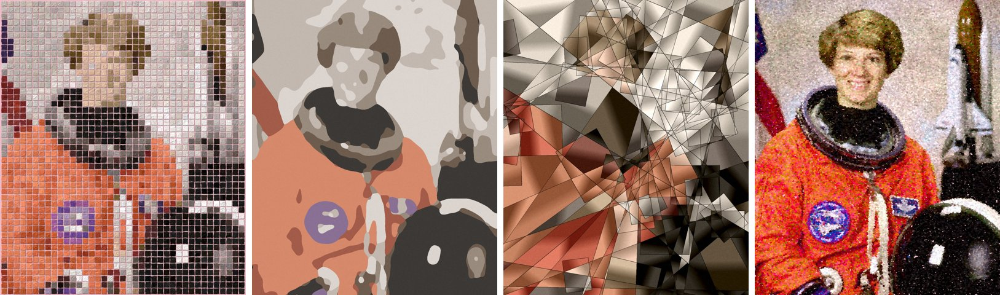

# Drawing Aide

Turn a photo into a painting. Pick a style, set the block or shape size, and Drawing Aide renders the
painting. For the block style it also gives you a paint-by-number sheet so you can paint it for real.



| Style | What it looks like | `--size` means |
|---|---|---|
| `blocks` | 1-inch knife-painted blocks on a pink (or white) grid, like a hand-painted pixel portrait | block size in inches, 0.5 to 3 (default 1) |
| `minimal` | a few flat, softly rounded colour fields | shape size 1 to 10 (default 4) |
| `cubist` | straight-edged fractured planes, each lit differently, dark contours | plane size 1 to 10 (default 4) |
| `pointillist` | dabs of boosted, hue-shifted colour | dot size 1 to 10 (default 3) |

## Install

Needs Python 3.10 or newer.

```
git clone https://github.com/mreindl118-boop/Drawing-Aide.git
cd Drawing-Aide
pip install -e .
```

## Use

```
drawing-aide photo.jpg                                   # block impasto, 100 x 120 cm, 1-inch blocks
drawing-aide photo.jpg --style cubist --size 3           # smaller planes
drawing-aide photo.jpg --size 1.5 --ground white         # 1.5-inch blocks on white canvas
drawing-aide photo.jpg --subject-only                    # leave a plain backdrop unpainted
drawing-aide photo.jpg --canvas 60 80 --colors 16        # different canvas and palette size
drawing-aide --list-styles
```

Results go to `./out` (change with `-o`). The canvas flips to landscape for landscape photos unless you
pass `--fixed-orientation`.

### What you get

For every photo:
- `<name>_<style>.jpg`: the painting.

For `blocks`, minimalist and cubist, also:
- `<name>_<style>_palette.json`: palette colours (numbered dark to light) and how much each is used.

For `blocks`, also:
- `<name>_blocks_paint_by_number.png`: numbered grid with row and column labels, and a colour legend
  with block counts.
- `<name>_blocks_grid.csv`: the palette number of every block, row by row.

### Hands-off folder mode

```
drawing-aide --folder "~/Google Drive/Paint Inbox" -o "~/Google Drive/Paintings" --watch
```

Converts every new or changed photo in the folder and keeps watching. Without `--watch` it runs once,
which suits a scheduled task (cron, Windows Task Scheduler). Converted files are tracked in
`manifest.json` in the output folder, so nothing is painted twice. Put a `drawing-aide.json` in the input
folder to change that folder's settings, for example:

```json
{"style": "blocks", "size": 1.5, "ground": "white", "canvas_cm": [80, 100]}
```

### From Python

```python
from drawing_aide import render, convert, Settings
from PIL import Image

res = render(Image.open("photo.jpg"), Settings(style="cubist", size=3))
res.image.save("cubist.jpg")

convert("photo.jpg", "out", style="blocks", size=1.0)   # writes all the files above
```

## Android app

Install the latest APK from [Releases](https://github.com/mreindl118-boop/Drawing-Aide/releases/latest).
The app runs the Style Studio, saves paintings to `Pictures/Drawing Aide`, accepts photos shared from
the gallery, and updates itself whenever a new release is published. See
[android/README.md](android/README.md) for how releases are built and signed.

## Browser version

`web/studio.html` is the Style Studio as a single page (the Android app wraps the same file). Open it in
any browser; nothing is uploaded. The painting sits on top with every control docked right under it
(beside it on wide screens). Rendering runs in a Web Worker, so dragging the slider or switching styles
never freezes the page, and a newer request cancels the older one.

Studio styles: Block impasto (with paint-by-number), Van Gogh, Geometric (minimal flat colours cut by
lines and circles), Impressionist, Cartoon, Retro anime, Vintage poster, Storybook pencil, Ink sketch,
Watercolour, Pop art, Cubist, Stained glass, Low poly, Minimalist and Pointillist. The canvas size can be
ratio locked (match photo, 5:6, 4:5, 3:4, 2:3, 1:1, 16:9) or free. The Python package currently covers
the first four classic styles (blocks, minimal, cubist, pointillist).

## Adding a style

Add a module to `src/drawing_aide/styles/` with `NAME`, `BLURB`, `SIZE` (label, min, max, default) and
`render(img, settings) -> Result`, then register it in `styles/__init__.py`. It shows up in the CLI and
in `--list-styles` automatically.

## Tests

```
pip install -e ".[test]"
pytest
```

The sample portrait in `examples/` is a public-domain NASA photo of astronaut Eileen Collins.
Licensed MIT.
